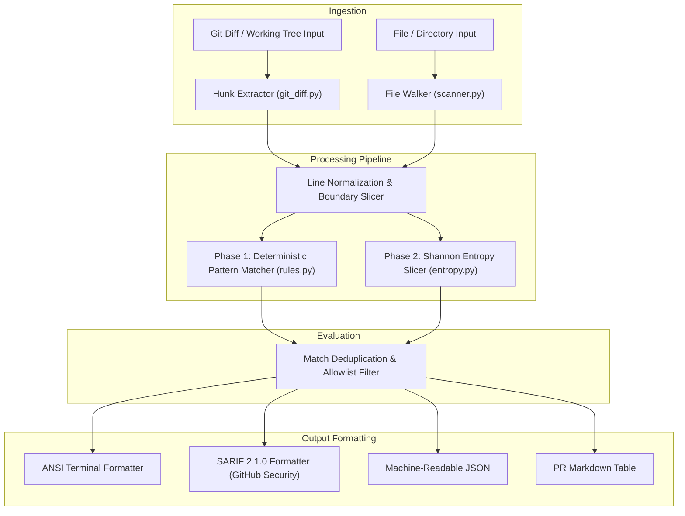

# 🏗️ Architecture & Internal Design

This document details the internal design, execution stages, and mathematical foundations powering **Secret Leak Guard**.

---

## 🔍 Scanner Pipeline Overview

The scanning workflow executes in five streamlined stages designed to minimize memory consumption and CPU cycle overhead:

---

## 📐 Mathematical Formulation: Shannon Entropy

In addition to deterministic regular expressions, Secret Leak Guard analyzes character distributions to detect unstructured high-entropy secrets (such as generated API tokens, symmetric encryption keys, and base64 hashes).

Shannon entropy is calculated as:

$$H(X) = -\sum_{i=1}^{n} P(x_i) \log_2 P(x_i)$$

Where:
- $X$ is the token byte sequence.
- $n$ is the count of distinct character bytes observed in $X$ (up to 256).
- $P(x_i) = \frac{\text{frequency}(x_i)}{N}$ represents the relative empirical probability.

### Typical Entropy Thresholds

| Content Type | Character Set | Typical $H(X)$ Range | Guard Treatment |
|---|---|---|---|
| Natural English Comments | ASCII Text | $2.5 - 3.4\text{ bits/char}$ | Ignored |
| Source Code Identifiers | CamelCase / snake_case | $2.8 - 3.7\text{ bits/char}$ | Ignored |
| MD5 / SHA256 Hex Hashes | Hexadecimal (`[0-9a-f]`) | $3.5 - 3.9\text{ bits/char}$ | Requires Rule Anchor |
| Standard Base64 Secret | Base64 (`[A-Za-z0-9+/=]`) | $4.3 - 5.8\text{ bits/char}$ | **Flagged High / Critical** |
| High-Entropy Binary/Hex Key | High Byte Spread | $> 4.5\text{ bits/char}$ | **Flagged Critical** |

---

## 📦 Core Modules

### 1. `git_diff.py`
Executes `git diff` with minimal context headers (`--unified=0`) and extracts only added lines (`+`). Each hunk is mapped back to the source file name and line number, ensuring zero false positives on context lines.

### 2. `rules.py`
Maintains pre-compiled regular expressions categorized across severity bands:
- `CRITICAL`: RSA private keys, AWS access secrets, Slack bot tokens, GitHub personal access tokens.
- `HIGH`: Generic bearer tokens, Stripe secret keys, database connection URIs.
- `MEDIUM`: Basic authorization headers, high-entropy variable assignments.
- `LOW`: Generic API keys with low entropy or ambiguous prefixes.

### 3. `entropy.py`
Zero-allocation frequency counter using fixed 256-element frequency lookup tables. Computes entropy in $O(N)$ time with minimal garbage collection overhead.

### 4. `formatters.py`
Formats findings for multiple destinations:
- **SARIF 2.1.0**: Standardized JSON conforming to the OASIS SARIF schema, allowing seamless ingestion into GitHub Advanced Security.
- **Markdown**: Formats neat collapsible tables suitable for GitHub PR comments.
- **JSON**: Raw structured payload for custom SIEM or pipeline integration.
