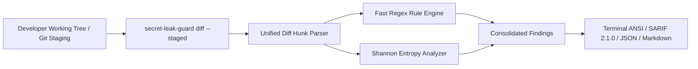

# 🛡️ Secret Leak Guard Documentation

Welcome to the official documentation for **Secret Leak Guard**, a high-performance, zero-dependency token and credential security scanner for git diffs, commits, and codebases.

---

## 📚 Documentation Index

| Guide | Description |
|---|---|
| [**Architecture**](Architecture.md) | Deep dive into the detection pipeline, AST/token slicing, Shannon entropy engine, and rule registry. |
| [**Quick Start**](Quick-Start.md) | Getting started in under 3 minutes: CLI commands, git pre-commit hook setup, and CI/CD pipelines. |
| [**Troubleshooting**](Troubleshooting.md) | Tuning entropy thresholds, suppressing false positives, resolving pre-commit hook conflicts, and debugging. |
| [**Performance Guide**](PERFORMANCE_GUIDE.md) | Benchmarks, algorithmic optimizations, and scaling to multi-gigabyte repositories. |

---

## 🌟 Key Capabilities

- **Zero External Dependencies**: Implemented entirely in the Python Standard Library for instant execution in restricted CI and air-gapped systems.
- **Git Diff Focused**: Evaluates only newly added (`+`) lines, saving CI run time and avoiding annoying alerts on grandfathered codebase files.
- **Algorithmic Shannon Entropy**: Computes symbol distribution ($H(X) = -\sum p_i \log_2 p_i$) to distinguish true random cryptographic material from readable identifiers.
- **OASIS SARIF 2.1.0 Ready**: Direct upload to GitHub Code Scanning tab to block pull requests before merge.
- **Instant Pre-commit Hook**: Zero-friction local git hook integration via `secret-leak-guard hook install`.
